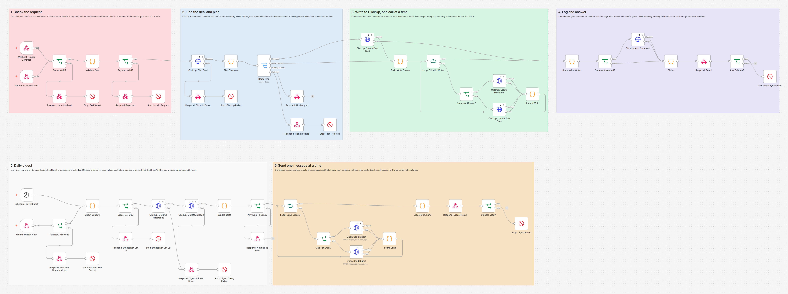
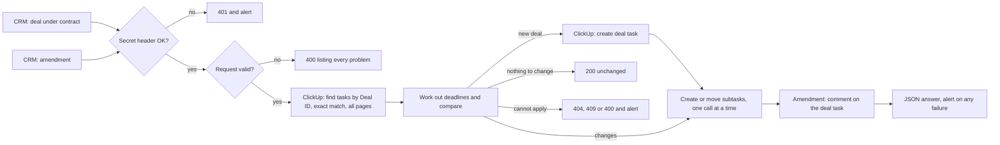
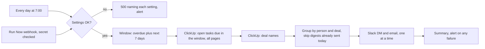

# Real Estate Deal Deadline Tracker in ClickUp

When a deal goes under contract, this n8n workflow builds the closing checklist in ClickUp with every contingency deadline worked out, keeps the dates right when the contract is amended, and sends each agent a daily digest of what is due and overdue.



## The problem

A purchase contract starts a clock. The inspection period, the appraisal and financing contingencies, earnest money and the closing date all count from the contract date, and missing one can cost the buyer their deposit or the agent the deal. Most teams still work these dates out by hand from the contract, type them into a task tool, and redo the math when an amendment moves the closing. A weekend or a holiday in the middle shifts a deadline, and that is exactly the kind of detail that gets missed.

## What this does

1. **Builds the checklist the moment a deal goes under contract.** Your CRM posts the deal to a webhook. The workflow creates one ClickUp task for the deal and one subtask per milestone: inspection, appraisal and financing contingencies, closing, and any custom milestones you send (earnest money, HOA documents, and so on).
2. **Works out every deadline from the contract date.** Calendar days from the contract date, due at 5:00 PM local time (configurable). A deadline that lands on a weekend or one of your holidays moves to the next business day, and the subtask says so. Daylight saving changes are handled.
3. **Assigns the right people.** The agent and the transaction coordinator are looked up by email in a team list you keep in the settings, so your CRM never needs ClickUp user IDs. Closing is marked urgent, contingencies high.
4. **Never creates a deal twice.** Every task carries the deal ID in a ClickUp custom field, and the lookup uses ClickUp's exact match, so `DEAL-10` never finds `DEAL-100`. A repeated webhook finds the existing tasks and changes nothing. If an earlier run stopped halfway, sending the same webhook again creates only what is missing. If the CRM sends the deal again with a different contract date, nothing is changed and the run raises an alert, because every deadline counts from that date.
5. **Handles amendments.** A second webhook takes a new closing date or a longer contingency period, moves the affected subtasks (and the deal task), and leaves a comment on the deal that says exactly what moved and from when to when. Sending the same amendment twice changes nothing. An amendment that would put closing on or before the contract date is refused.
6. **Sends a daily digest.** Every morning, ClickUp is asked for open milestones that are overdue or due within the next 7 days. Each person gets one Slack direct message and one email, grouped by deal, overdue items first. A Run Now webhook sends it on demand. The same digest is never sent twice on the same day.
7. **Fails loudly and safely.** Requests without the secret are refused, bad requests get a 400 that lists every problem, missing settings get a 500 that names each one, and every failure (ClickUp down, a subtask that would not save, a Slack message that bounced) ends the run with a clear message for the error alert workflow.

## How it works



"Cannot apply" covers an amendment for a deal that is not in ClickUp (404), a deal resent with a different contract date or a deal task whose start date was cleared (409), and an amendment that moves closing to the contract date or earlier (400).



ClickUp is the record. The deal task holds the address, the assignees, the contract date (as its start date) and the closing (as its due date). Each milestone subtask holds its deadline and two custom fields: the deal ID and a milestone key such as `inspection` or `closing`. Because the workflow always reads ClickUp first, it does not depend on anything stored inside n8n to avoid duplicates.

**Why one ClickUp call at a time.** n8n retries a node by running it again with all of its items, and it only checks the first item to decide. A node that creates six subtasks at once and hits a rate limit on the first one would create the other five twice; a failure on the fourth would not be retried at all. The two loops in this workflow send one request per pass, so a retry repeats only the call that failed.

## Workflow at a glance

| Step | Nodes | What it does |
|---|---|---|
| 1 | Webhook: Under Contract, Webhook: Amendment | Receive the CRM's POST requests (two URLs, one pipeline). They answer when the work is done, usually within a few seconds |
| 2 | Secret Valid?, Respond: Unauthorized, Stop: Bad Secret | Compares the `X-Webhook-Secret` header with `WEBHOOK_SECRET`. Fails closed when the secret is not set |
| 3 | Validate Deal, Payload Valid?, Respond: Rejected, Stop: Invalid Request | Checks the body and the settings. A bad request gets a 400 that lists every problem; a settings problem gets a 500 |
| 4 | ClickUp: Find Deal, Respond: ClickUp Down, Stop: ClickUp Failed | Reads every task and subtask with this deal ID (ClickUp's exact match, `==`), closed ones too, page by page |
| 5 | Plan Changes, Route Plan | Works out each deadline and compares it with ClickUp: new deal, changes to write, nothing to write, or rejected |
| 6 | Respond: Unchanged, Respond: Plan Rejected, Stop: Plan Rejected | A repeated webhook gets 200 "unchanged". A request that cannot be applied (unknown deal, a different contract date, closing before the contract date) gets a 404, 409 or 400 and an alert |
| 7 | ClickUp: Create Deal Task | The deal task: address, agent and coordinator, contract date as start date, closing as due date, deal ID |
| 8 | Build Write Queue, Loop: ClickUp Writes, Create or Update?, ClickUp: Create Milestone, ClickUp: Update Due Date, Record Write | Creates or moves each subtask, one ClickUp call per pass, and records the result |
| 9 | Summarize Writes, Comment Needed?, ClickUp: Add Comment | Collects the results. For amendments, comments on the deal task with every date that moved |
| 10 | Finish, Respond: Result, Any Failures?, Stop: Deal Sync Failed | Answers the CRM with a JSON summary, and ends the run as failed if anything did not save |
| 11 | Schedule: Daily Digest, Webhook: Run Now, Run Now Allowed? | Two ways to start the digest. Run Now needs the same secret header |
| 12 | Digest Window, Digest Set Up?, Respond: Digest Not Set Up, Stop: Digest Not Set Up | Checks the digest settings (a 500 naming each problem if one is wrong), then sets the window: overdue items (up to 60 days back) plus everything due by the end of the day 7 days from now |
| 13 | ClickUp: Get Due Milestones, ClickUp: Get Open Deals | Uses ClickUp's `due_date_gt` and `due_date_lt` filters, page by page, then reads the deal names once |
| 14 | Build Digests, Anything To Send?, Respond: Nothing To Send | Groups by person and deal, builds the Slack text and the email, and skips what already went out today |
| 15 | Loop: Send Digests, Slack or Email?, Slack: Send Digest, Email: Send Digest, Record Send | Sends one message per pass. Slack answers 200 even when it refuses a message, so its `ok` field is checked |
| 16 | Digest Summary, Respond: Digest Result, Digest Failed?, Stop: Digest Failed | Reports what was sent, skipped and failed, and raises an alert for any failure |

## Deadline rules

| Milestone | Due | Priority |
|---|---|---|
| Inspection contingency ends | Contract date + `inspection_days` | High |
| Appraisal contingency ends | Contract date + `appraisal_days` | High |
| Financing contingency ends | Contract date + `financing_days` | High |
| Custom milestones | Contract date + `days` | Normal, or the `priority` you send |
| Closing | `closing_date` | Urgent |

Every deadline is due at `DEADLINE_TIME` (default 17:00) in `TIMEZONE`. Days are calendar days. When a deadline falls on a Saturday, Sunday or a date in `HOLIDAYS`, it moves to the next business day, unless `ROLL_TO_BUSINESS_DAY=false` or the request says `"roll_to_business_day": false` (some contracts do not roll). Leave a contingency out, or send 0, and that milestone is skipped, which is what a cash deal needs. A milestone that ends after closing is flagged in the answer.

## What the CRM sends

**Deal under contract:** `POST https://YOUR-N8N-DOMAIN/webhook/deal-under-contract` with the header `X-Webhook-Secret`.

```json
{
  "deal_id": "DEAL-1001",
  "property_address": "1428 Elm Street, Springfield, IL 62704",
  "side": "buyer",
  "agent_email": "jordan.lee@example.com",
  "contract_date": "2026-10-20",
  "closing_date": "2026-11-20",
  "inspection_days": 10,
  "appraisal_days": 18,
  "financing_days": 22,
  "custom_milestones": [
    { "name": "Earnest money due", "days": 3 },
    { "name": "HOA documents review", "days": 12, "priority": "high" }
  ]
}
```

`side` is `buyer`, `seller` or `dual`. `tc_email` and `roll_to_business_day` are optional.

**Amendment:** `POST https://YOUR-N8N-DOMAIN/webhook/deal-amendment`

```json
{
  "deal_id": "DEAL-1001",
  "amendment_id": "AMD-1",
  "new_closing_date": "2026-11-25",
  "financing_days": 25,
  "note": "Lender asked for more time"
}
```

An amendment carries the new total period, not the difference ("financing is now 25 days", not "add 3 days"), so a repeated delivery changes nothing. It can also add a contingency the deal did not have, or change or add custom milestones by name.

**Run the digest now:** `POST https://YOUR-N8N-DOMAIN/webhook/deal-digest-run` with an empty body, or `{"force": true}` to send it again even if it already went out today.

## What the team gets

For the deal above, ClickUp gets one deal task and six subtasks. The answer to the CRM, taken from the test run (shortened):

```json
{
  "ok": true,
  "status": "created",
  "deal_id": "DEAL-1001",
  "task_url": "https://app.clickup.com/t/86b00001",
  "milestones": [
    { "key": "custom:earnest-money-due", "name": "Earnest money due", "due": "2026-10-23T17:00:00-05:00", "rolled_from": null },
    { "key": "inspection", "name": "Inspection contingency ends", "due": "2026-10-30T17:00:00-05:00", "rolled_from": null },
    { "key": "custom:hoa-documents-review", "name": "HOA documents review", "due": "2026-11-02T17:00:00-06:00", "rolled_from": "2026-11-01" },
    { "key": "appraisal", "name": "Appraisal contingency ends", "due": "2026-11-09T17:00:00-06:00", "rolled_from": "2026-11-07" },
    { "key": "financing", "name": "Financing contingency ends", "due": "2026-11-12T17:00:00-06:00", "rolled_from": "2026-11-11" },
    { "key": "closing", "name": "Closing", "due": "2026-11-20T17:00:00-06:00", "rolled_from": null }
  ],
  "failed": [],
  "warnings": []
}
```

November 1 is a Sunday, November 7 a Saturday and November 11 a holiday in the test settings, so those three moved. The amendment above leaves this comment on the deal task:

```
Deadlines changed by amendment AMD-1.
Note from the sender: Lender asked for more time

Financing contingency ends: moved from Thu Nov 12, 2026 5:00 PM CST to Mon Nov 16, 2026 5:00 PM CST
Closing: moved from Fri Nov 20, 2026 5:00 PM CST to Wed Nov 25, 2026 5:00 PM CST
```

And the agent's morning Slack message looks like this (each name is a link to the ClickUp task, all data made up):

```
Deal deadlines for Jordan Lee, Tuesday, Oct 20, 2026
2 overdue, 2 due in the next 7 days.

Loft 4 <Harbor> & Pier, 77 Harbor Road, Bayview, CA 94000 (DEAL-2001)
• OVERDUE Earnest money due: Thu Oct 8, 5:00 PM, 12 days overdue
• OVERDUE Inspection contingency ends: Thu Oct 15, 5:00 PM, 5 days overdue
• Closing: Fri Oct 23, 5:00 PM, due in 3 days

1428 Elm Street, Springfield, IL 62704 (DEAL-1001)
• Earnest money due: Fri Oct 23, 5:00 PM, due in 3 days
```

The email has the same content as HTML, with a plain text version. The transaction coordinator is on every deal, so their digest covers the whole pipeline.

## Setup

**You need:** self-hosted n8n reachable over HTTPS, a ClickUp workspace, and for the digest a Slack app and/or a [Resend](https://resend.com) account. Step by step for each service, including how to find every ID: [docs/setup.md](docs/setup.md).

1. In ClickUp, pick (or create) the list for your deals and add two **Text** custom fields to it: "Deal ID" and "Milestone".
2. Import `workflow/real-estate-deal-deadlines-clickup.json` into n8n. For failure alerts, also import `workflow/error-alert-slack.json` and **activate it** (n8n 2.x only runs an error workflow that is active).
3. Add the variables below to your n8n environment and restart n8n. The nodes read them with `$env`, so self-hosted n8n needs `N8N_BLOCK_ENV_ACCESS_IN_NODE=false`. (n8n Cloud does not allow `$env`. There, replace `$env.` with `$vars.` and create the same names under Variables.)
4. In the workflow settings, choose the error alert workflow as its **Error Workflow**, and set the **Timezone** to the same zone as `TIMEZONE` so the digest goes out at 7:00 local time.
5. Activate the workflow and point your CRM at the two deal webhooks with the `X-Webhook-Secret` header.

| Variable | Required | Where to find it |
|---|---|---|
| `WEBHOOK_SECRET` | yes | Any long random string you make up. Your CRM sends it in the `X-Webhook-Secret` header |
| `CLICKUP_API_TOKEN` | yes | ClickUp → avatar → Settings → Apps → API Token (starts with `pk_`). Best made on a dedicated integration user |
| `CLICKUP_LIST_ID` | yes | Open the list in ClickUp; it is the number after `/li/` in the URL |
| `CLICKUP_DEAL_ID_FIELD_ID` | yes | The "Deal ID" Text field. `GET https://api.clickup.com/api/v2/list/{list_id}/field` lists the IDs |
| `CLICKUP_MILESTONE_FIELD_ID` | yes | The "Milestone" Text field, from the same call |
| `TEAM_MEMBERS` | yes | A JSON list of agents and coordinators: `name`, `email`, `clickup_id` (from `GET https://api.clickup.com/api/v2/team`) and, for Slack, `slack_id` (Slack profile → three dots → Copy member ID) |
| `TC_EMAIL` | no | The transaction coordinator assigned to every deal. Must be in `TEAM_MEMBERS` |
| `TIMEZONE` | yes | Your office time zone, for example `America/Chicago` |
| `DEADLINE_TIME` | no | Local time every deadline is due, default `17:00` |
| `ROLL_TO_BUSINESS_DAY` | no | `true` (default) moves weekend and holiday deadlines to the next business day |
| `HOLIDAYS` | no | Dates that are not business days, comma separated, for example `2026-11-26,2026-12-25` |
| `DIGEST_DAYS` | no | How far ahead the digest looks, default `7` |
| `DIGEST_OVERDUE_DAYS` | no | How far back it shows overdue items, default `60` |
| `DIGEST_CHANNELS` | no | `slack`, `email` or `slack,email` (default). Each channel you list needs its keys below, or the digest stops with a 500 that names the missing one |
| `SLACK_BOT_TOKEN` | for Slack | A Slack app with the `chat:write` scope → Install to workspace → Bot User OAuth Token (`xoxb-`) |
| `EMAIL_API_KEY` | for email | Resend → API Keys, with sending access |
| `EMAIL_FROM` | for email | A sender on a domain you verified in Resend, for example `Deal Desk <deals@example.com>` |
| `SLACK_WEBHOOK_URL` | no | A Slack incoming webhook for failure alerts, used by the error alert workflow |

## Testing

The workflow was tested end to end on n8n 2.19.5 against **mock ClickUp, Slack and Resend APIs**, so no real account was touched. The mock ClickUp keeps state like the real one (tasks, subtasks, custom fields, comments, due date filters, closed tasks, paging) and rejects malformed requests the way the real API does: a missing or wrong token, a `Bearer` prefix on a personal token, the wrong content type, a task without a name, an unknown custom field or parent, an assignee outside the workspace, or a bad filter. Its custom field filter follows ClickUp's documented operators for text fields (`=` contains, `==` exact). It pages at 5 tasks instead of 100 so paging is exercised. The expected dates are worked out independently in the test script with Python's time zone database.

All 57 checks across 38 scenarios pass:

| Scenario | Result |
|---|---|
| Forged requests (no secret or a wrong secret on the deal webhooks, a wrong secret on Run Now) | 401, ClickUp never called |
| `WEBHOOK_SECRET` not set | Every request refused, even with an empty header |
| Invalid deal (7 problems in one request), closing before contract, amendment that changes the contract date | 400 listing every problem, ClickUp never called |
| Settings missing or wrong | 500 naming each setting before any ClickUp call, on the deal webhook and on Run Now |
| New deal | 1 lookup with the exact match operator, 1 deal task, 6 subtasks in date order with exact due dates, priorities, assignees and custom fields |
| Weekend, holiday and daylight saving dates | Nov 1 (Sunday), Nov 7 (Saturday) and Nov 11 (holiday) move; 5:00 PM local on both sides of the time change |
| Same deal sent twice, or again with a different closing date | Nothing created or changed; the answer says to send an amendment |
| Same deal sent again with a different contract date | 409 and an alert, nothing written |
| `DEAL-100` sent while `DEAL-1001` exists | Created as its own deal; the lookup returns nothing from `DEAL-1001` |
| ClickUp refuses the deal task (500), then recovers | 502 after 3 tries, no subtask written, an alert; resending creates the whole deal once |
| ClickUp rate limits a subtask (429) | Retried, every milestone exists exactly once |
| ClickUp keeps failing one subtask (500), then recovers | 502 with the failed milestone and an alert; resending the webhook creates only the missing subtask |
| Agent not in the team list, `roll_to_business_day: false`, a contingency after closing | Assigned to the coordinator only with a warning; Saturday dates stay; the late contingency is flagged |
| Amendment (new closing, longer financing) | Moves both subtasks and the deal task, one comment with the exact changes |
| Same amendment twice, amendment that adds a contingency, amendment for an unknown deal | No change; one new subtask and a comment; 404 and an alert |
| Amendment that moves closing before the contract date, deal task with its start date cleared | 400 and 409, nothing written, an alert each |
| ClickUp refuses the comment, or is down | Dates still saved and the alert carries the comment text; 502 after 3 tries, nothing written |
| Digest | Exact due date window and paging, one message per person grouped by deal, completed and later tasks left out, names escaped for Slack and HTML |
| Slack refuses one DM, Resend rate limits one email | The others go out, the email is retried with the same Idempotency-Key, 502 and an alert |
| Digest run again, a third time, after an amendment, with `force` | Only the failed DM is resent; nothing; only the two people on that deal; everyone |
| The real schedule trigger (cron, not Run Now) | Same digest, only changed digests sent |
| ClickUp down during the digest | 502 after 3 tries, nothing sent |
| Error workflow | Exactly one Slack alert per failed run (22 of 22), matched to its run through the execution link, naming the node it stopped at and carrying the run's message |

Full results, the requests the workflow sent and what testing found: [docs/test-report.md](docs/test-report.md). Run the same tests yourself with [tests/e2e_mock_test.py](tests/e2e_mock_test.py) (1 to 2 minutes, including up to a minute of waiting for the cron trigger). What testing and review found and fixed is in [CHANGELOG.md](CHANGELOG.md).

## What it handles when things go wrong

| Situation | What happens |
|---|---|
| Request without the right secret | 401, nothing touched, alert |
| Missing or impossible values (February 30, closing before contract, negative days) | 400 that lists every problem, alert |
| Settings missing or wrong (a list ID, a coordinator not in the team, a digest channel without its key) | 500 that names each setting, before any ClickUp call, alert |
| The same deal or amendment delivered twice | 200 "unchanged", nothing written |
| The same deal resent with a different contract date | 409, nothing written, alert. Every deadline counts from the contract date, so mixing two would leave some of them wrong |
| A deal ID that is part of another one (`DEAL-10` and `DEAL-100`) | Kept apart: the lookup uses ClickUp's exact match (`==`), not its fuzzy `=` |
| A run stopped halfway (ClickUp outage, rate limit) | The sender gets 502 with the milestones that failed. Sending the same webhook again finishes the job without duplicates |
| ClickUp refuses the deal task itself | 502, no subtask is written, alert. Sending the same webhook again creates the whole deal |
| ClickUp rate limit (429) or a short outage | Each call is retried 3 times, 2 seconds apart, one call at a time |
| Amendment for a deal that was never created | 404 and an alert, so the missing deal can be added |
| Amendment that moves closing to the contract date or earlier | 400, nothing written, alert |
| Someone cleared the deal task's start date in ClickUp | Amendments get a 409 and an alert until the start date is set back to the contract date |
| Agent not in the team list | Tasks go to the coordinator, the answer carries a warning |
| A contingency that ends after closing | Flagged in the answer and in the amendment comment |
| The comment on an amendment fails | Dates stay updated, the alert includes the comment so it can be added by hand |
| Slack refuses a message with `ok: false` | Counted as a failure, not a success. The other messages still go out, and the next run sends only what failed |
| A digest run twice the same day | People who already got the same digest are skipped; email also carries an Idempotency-Key, so a retried email is never delivered twice |
| Deal names with `<`, `>` or `&` | Escaped for Slack and HTML email; only `https://` task links are used |

## API usage

A new deal with six milestones uses 8 ClickUp calls, an amendment 3 to 6, and a digest 2 to 4 for a small team plus one Slack and one email call per person. ClickUp allows 100 calls a minute per token on the Free, Unlimited and Business plans and more on higher plans, so normal volume stays far below the limit.

## Limitations and next steps

- Two deliveries of the same new deal within the same second can both find nothing and both create the deal. ClickUp has no unique key to prevent that. Re-delivery a few seconds later is safe, and the workflow warns when it finds two deal tasks with one ID.
- The contract date cannot be changed, by an amendment or by resending the deal, because every deadline counts from it. To restart a deal from a new contract date, delete its deal task and subtasks in ClickUp and send the under contract webhook again.
- An amendment can move or add milestones but not remove one. When a contingency is waived, complete or delete its subtask in ClickUp by hand.
- An amendment rewrites the description of each subtask it moves, so the rule shown there stays right. Notes belong in task comments, which are never touched.
- Days are calendar days. Contracts that count some periods in business days, or count back from closing (like a final walkthrough the day before), are not modelled yet; both would be a small change in "Plan Changes".
- `roll_to_business_day` in a request applies to the dates in that request only. If a deal does not use the rule, send it with its amendments too.
- The retries wait 2 seconds, and ClickUp's rate limit window is a minute. A bulk import of many deals at once (more than about 12 new deals a minute on the 100 calls per minute plans) can run out of retries; those deals get a 502 and an alert and can be sent again.
- Digest deduplication lives in n8n's workflow static data, which is saved once per run. Two digest runs at the same moment could both send. Deal tasks do not depend on it.
- API keys are read from environment variables. For production, move them into n8n credentials so they never appear in the workflow.
- The webhook trusts a shared secret header, not a signature. If your CRM can sign requests, an HMAC check would be stronger.
- Every forged request raises an alert, which could get noisy if the URL leaks. Rotate `WEBHOOK_SECRET` if that happens.
- Email goes through Resend. Another provider needs its own URL and body in "Email: Send Digest".

## About

Built by **Romiel Inolino**, AI and CRM Automation Specialist working with GoHighLevel, Monday.com, ClickUp, n8n, Make and Zapier.
Portfolio and case studies: [romielwillautomate.dev](https://romielwillautomate.dev)

This repository is a portfolio implementation. Credentials, API keys and customer data are not included, and all test data is made up.
